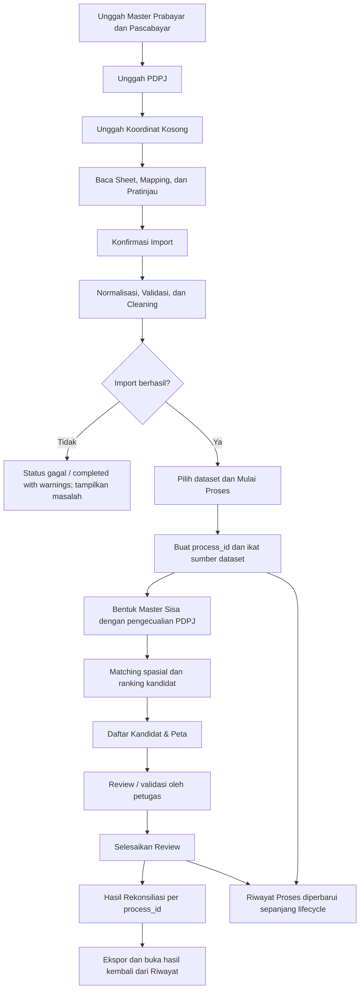
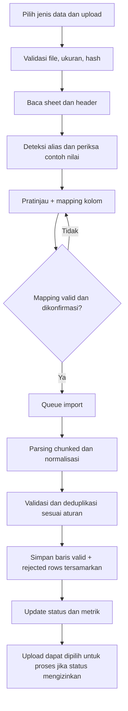
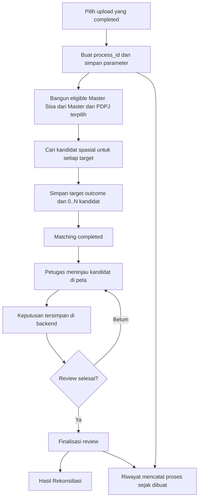
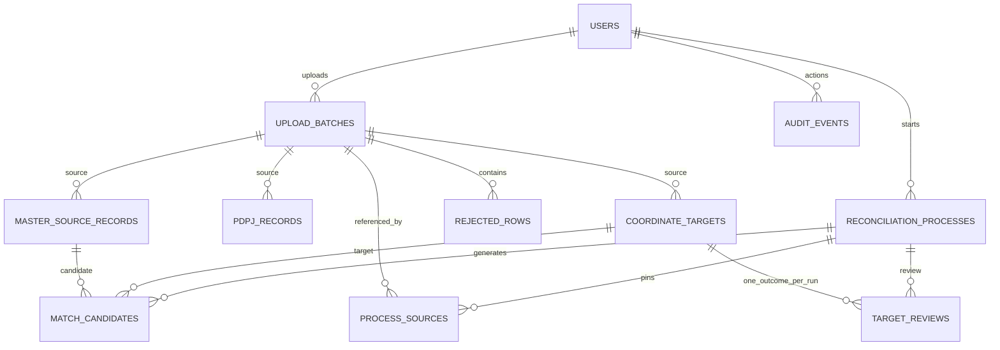
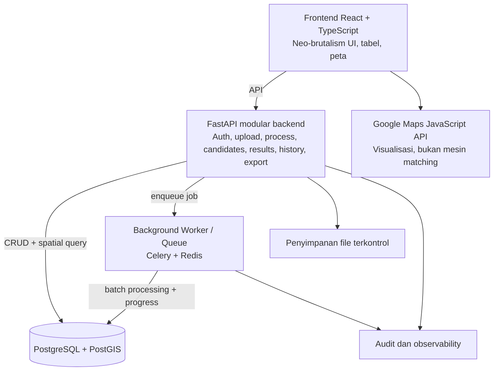

**Status dokumen:** Draft dasar pembangunan ulang — perlu validasi pemilik proses bisnis  
**Jenis dokumen:** Product Requirements Document  
**Bahasa:** Indonesia  
**Tujuan:** Menjadi acuan utama untuk desain, pengembangan, pengujian, dan serah terima aplikasi.

> **Catatan penting:** Dokumen ini disusun dari konteks kebutuhan yang telah dijelaskan. Dokumen ini bukan standar resmi PLN dan tidak menggantikan konfirmasi dari pemilik data/proses. Bagian yang belum memiliki aturan pasti ditandai sebagai keputusan yang harus dikonfirmasi. Jangan mengimplementasikan asumsi yang berisiko mengubah atau menghilangkan data secara permanen tanpa persetujuan.

# Daftar Isi

1. Ringkasan Produk  
2. Masalah, Tujuan, dan Ukuran Keberhasilan  
3. Pengguna dan Hak Akses  
4. Glosarium dan Definisi Data  
5. Scope Produk  
6. Aturan Bisnis  
7. Flow Sistem End-to-End  
8. Kebutuhan Fungsional  
9. Status, Siklus Hidup Proses, dan Perhitungan Statistik  
10. Rancangan Data Konseptual  
11. Arsitektur Teknis yang Direkomendasikan  
12. Spesifikasi UI/UX Neo-Brutalism  
13. Kebutuhan Nonfungsional  
14. Acceptance Criteria dan Strategi Pengujian  
15. Roadmap Implementasi  
16. Risiko dan Mitigasi  
17. Keputusan yang Masih Harus Dikonfirmasi  
18. Definisi Selesai Produk

# 1. Ringkasan Produk

PLN GeoMatch adalah aplikasi web internal untuk membantu petugas mengolah data pelanggan dari berbagai periode, mengidentifikasi ID pelanggan (IDPEL) yang sudah atau belum terverifikasi, mencari kandidat IDPEL berdasarkan kedekatan koordinat geografis, dan menyimpan keputusan verifikasi dalam proses yang dapat ditelusuri.

Sistem bukan hanya alat visualisasi peta atau tempat mengunggah Excel. Sistem harus menyediakan rangkaian proses yang konsisten dari data sumber hingga hasil rekonsiliasi: import, pemetaan kolom dinamis, validasi, cleaning, pembentukan kandidat Master, pengecualian IDPEL berdasarkan PDPJ, matching spasial, pemeriksaan oleh petugas, hasil per proses, ekspor, dan riwayat.

Produk harus dirancang agar proses bulanan baru tidak mencampur atau menimpa hasil bulan sebelumnya. Setiap proses memiliki identitas unik (`process_id`), dataset sumber yang tercatat, parameter matching, kandidat yang dihasilkan, keputusan petugas, status, waktu, dan hasil yang dapat dibuka kembali.

## Prinsip produk

1. **Data sumber tidak hilang.** Cleaning dan deduplikasi tidak boleh menghapus jejak sumber atau riwayat antarperiode.
2. **Matching bukan verifikasi.** Kedekatan koordinat menghasilkan kandidat; keputusan valid akhir memerlukan konfirmasi petugas sesuai aturan operasional.
3. **Setiap hasil terikat pada proses.** Proses berbeda tidak boleh mencampur hasil atau statistik.
4. **Excel dinamis harus ditangani melalui mapping.** Sistem tidak bergantung pada urutan atau nama kolom yang persis sama setiap bulan.
5. **Database adalah sumber kebenaran.** Frontend tidak boleh menjadi satu-satunya tempat penyimpanan keputusan atau statistik.
6. **Kegagalan harus terlihat.** Error import, matching, history, atau export tidak boleh disamarkan sebagai hasil kosong atau sukses.
7. **UI neo-brutalism harus tetap operasional.** Tampilan tegas dan ekspresif, tetapi tabel, peta, form, dan status harus mudah digunakan.

# 2. Masalah, Tujuan, dan Ukuran Keberhasilan

## 2.1 Masalah yang hendak diselesaikan

- Data Prabayar dan Pascabayar berasal dari banyak file/periode dan perlu digabungkan.
- Header, susunan kolom, sheet, serta tipe data Excel dapat berbeda antarbulan.
- Data dapat mengandung duplikasi, IDPEL kosong, IDPEL tidak ditemukan, koordinat tidak valid, atau satu IDPEL dengan koordinat yang berbeda.
- Daftar IDPEL pada PDPJ perlu digunakan untuk mengecualikan pelanggan yang telah valid sesuai aturan yang disepakati.
- Titik koordinat yang memerlukan pencarian perlu dibandingkan dengan kandidat dari Master yang memenuhi syarat.
- Kandidat perlu diperiksa melalui tabel dan peta, serta disetujui/ditolak oleh petugas.
- Riwayat eksekusi, hasil rekonsiliasi, dan log aktivitas harus memiliki fungsi yang berbeda tetapi saling terhubung.
- Sistem perlu tetap stabil saat jumlah data besar dan ketika beberapa proses bulanan dijalankan.

## 2.2 Tujuan produk

- Mengurangi pekerjaan pencocokan manual berulang.
- Mempercepat penemuan kandidat IDPEL untuk titik yang belum jelas.
- Membuat proses import dan matching dapat diulang secara aman.
- Meningkatkan keterlacakan sumber data, keputusan, dan hasil.
- Memberikan hasil per proses yang dapat diperiksa, difilter, dan diekspor.
- Mengurangi risiko data berbeda bulan tercampur atau data lama tertimpa tanpa sengaja.

## 2.3 Ukuran keberhasilan

| ID | Indikator | Kriteria keberhasilan |
|---|---|---|
| KPI-01 | Keberhasilan import | File valid bisa diproses dan ringkasan baris sesuai hasil aktual; baris invalid memiliki alasan. |
| KPI-02 | Integritas sumber | Setiap record hasil bisa ditelusuri ke upload/periode/baris sumber yang tersedia. |
| KPI-03 | Konsistensi proses | Hasil, keputusan, dan statistik terkait pada `process_id` yang sama. |
| KPI-04 | Keakuratan status | Kandidat belum otomatis menjadi valid sebelum keputusan petugas disimpan. |
| KPI-05 | Keterlacakan histori | Proses lama dapat dibuka kembali setelah proses baru dibuat. |
| KPI-06 | Performa | Uji benchmark dilakukan dengan dataset representatif; target waktu disepakati berdasarkan hasil pengukuran, bukan asumsi. |
| KPI-07 | Ketahanan | Job gagal tidak meninggalkan data aktif parsial yang dapat dianggap hasil selesai. |
| KPI-08 | Kemudahan penggunaan | Petugas dapat menyelesaikan alur upload, pencocokan, review, hasil, dan ekspor melalui UI tanpa manipulasi database manual. |

# 3. Pengguna dan Hak Akses

## 3.1 Peran minimal

| Peran | Kebutuhan dan izin utama |
|---|---|
| **Analis/Petugas** | Mengunggah data, mengonfirmasi mapping, menjalankan proses, meninjau kandidat, menyimpan keputusan, melihat hasil, dan mengekspor sesuai kewenangan. |
| **Admin** | Mengelola pengguna/role, konfigurasi terkontrol, melihat semua proses, dan menangani dukungan aplikasi. Hak admin harus tetap diaudit. |
| **Auditor/Pembaca** | Melihat hasil, histori, dan audit log secara read-only jika diberi izin; tidak mengubah hasil atau data sumber. |

Role dan hak akses final harus menyesuaikan kebijakan internal organisasi. Jangan menyamakan akses membaca data sensitif dengan hak mengubah atau mengekspornya.

## 3.2 Prinsip otorisasi

- Hak akses diperiksa di backend untuk setiap endpoint; menyembunyikan tombol pada frontend tidak cukup.
- Ekspor data sensitif memerlukan izin yang sesuai dan harus tercatat di audit log.
- Perubahan hasil final, pembukaan ulang review, perubahan mapping sesudah import, serta pengubahan konfigurasi radius harus memiliki jejak audit yang jelas.
- Tidak boleh ada bypass autentikasi atau penerimaan token mock pada konfigurasi penggunaan data nyata.

# 4. Glosarium dan Definisi Data

| Istilah | Definisi operasional dalam PRD |
|---|---|
| **IDPEL** | Nomor identitas pelanggan. Disimpan dan diproses sebagai string agar format angka tidak berubah. |
| **Master** | Hasil gabungan catatan pelanggan Prabayar dan Pascabayar dari satu atau beberapa upload/periode yang memenuhi aturan normalisasi. |
| **PDPJ** | Daftar IDPEL yang menjadi sumber pengecualian pelanggan yang sudah terverifikasi menurut proses operasional. |
| **Master Sisa** | Kumpulan kandidat Master setelah IDPEL yang ada pada dataset PDPJ terpilih dikecualikan sesuai aturan matching. |
| **Koordinat Kosong** | Titik yang memerlukan pencocokan karena IDPEL kosong atau tidak ditemukan berdasarkan klasifikasi sumber. Istilah ini tidak berarti koordinatnya pasti kosong; sering kali titik koordinat justru tersedia. |
| **Titik survei/target** | Satu lokasi dari sumber Koordinat Kosong yang menjadi unit pekerjaan matching. Setiap titik memiliki identitas stabil di dalam upload/proses. |
| **Kandidat** | Satu record lokasi Master yang memenuhi kriteria pencarian untuk satu titik survei. Satu titik dapat memiliki nol, satu, atau beberapa kandidat. |
| **Matching** | Proses otomatis mencari dan memberi peringkat kandidat berdasarkan koordinat dan aturan yang disepakati. |
| **Verifikasi/review** | Keputusan petugas terhadap kandidat atau titik survei. Keputusan ini berbeda dari hasil matching otomatis. |
| **Hasil Rekonsiliasi** | Ringkasan dan detail hasil satu proses: kandidat, keputusan, status akhir per titik, dan data ekspor. |
| **Riwayat Proses** | Catatan setiap eksekusi matching dan siklus review beserta status, waktu, sumber data, operator, dan ringkasan hasil. |
| **Audit Log** | Catatan tindakan pengguna dan perubahan penting; berbeda dari Riwayat Proses. |
| **Upload batch** | Satu file yang diunggah, beserta metadata, mapping, status import, dan metriknya. |
| **Konflik koordinat** | Kondisi ketika IDPEL sama muncul dengan koordinat berbeda secara bermakna antarrecord/periode. Bukan otomatis bukti bahwa satu koordinat salah. |
| **Titik tidak memiliki kandidat dalam radius** | Tidak ada record Master yang memenuhi radius matching yang dipakai pada proses itu; tidak menyatakan secara mutlak IDPEL tidak ada di seluruh sumber. |

# 5. Scope Produk

## 5.1 Termasuk dalam MVP

- Autentikasi dan hak akses dasar.
- Upload Master Prabayar, Master Pascabayar, PDPJ, serta Koordinat Kosong.
- Dukungan file CSV dan XLSX. Dukungan XLS biner lama harus dipastikan dengan library dan pengujian tersendiri sebelum dijanjikan.
- Pembacaan multi-sheet, deteksi header, alias kolom, pratinjau, dan mapping manual.
- Validasi, normalisasi, deduplikasi yang aman, rejected rows yang tersamarkan, dan ringkasan import.
- Pembentukan kandidat Master dan pengecualian PDPJ sesuai dataset yang dipilih.
- Pencarian kandidat spasial berbasis PostGIS dan parameter radius.
- Daftar Kandidat & Peta, pilihan kandidat, keputusan valid/tolak, review dan finalisasi.
- Halaman Hasil Rekonsiliasi per proses.
- Riwayat Proses, akses kembali ke hasil, dan log status.
- Ekspor hasil per proses.
- Input manual terbatas untuk kasus yang disepakati.
- Audit log tindakan penting dan pengujian end-to-end.

## 5.2 Di luar scope MVP atau fase lanjutan

- Integrasi DIL/kode gardu, kecuali menjadi kebutuhan wajib setelah validasi bisnis.
- Otomatisasi keputusan valid final tanpa petugas.
- Pembuatan atau pengiriman pembayaran, billing, atau fungsi operasional PLN di luar rekonsiliasi koordinat.
- Pemakaian AI/LLM untuk menebak IDPEL atau mengambil keputusan verifikasi.
- Geocoding atau pemanggilan layanan peta per baris sebagai pengganti pencocokan spasial database.
- Infrastruktur microservices yang terpisah per fitur tanpa alasan skala/organisasi yang jelas.

# 6. Aturan Bisnis

Aturan berikut menjadi baseline desain. Item bertanda **[KONFIRMASI]** harus disepakati dengan pemilik proses bisnis sebelum diperlakukan sebagai kebijakan resmi.

| ID | Aturan |
|---|---|
| BR-001 | File sumber tidak dihapus oleh proses cleaning. Simpan metadata sumber dan, sesuai kebijakan retensi, file asli secara terkontrol. |
| BR-002 | Import hanya boleh diproses setelah file valid, mapping wajib dikonfirmasi, dan status upload memenuhi prasyarat. |
| BR-003 | Satu upload memiliki `upload_id` unik, hash file, jenis data, periode jika tersedia, pembuat, mapping, status, dan ringkasan metrik. |
| BR-004 | Sistem memakai mapping yang dikonfirmasi ketika parsing penuh. Auto-detection hanya membantu membuat saran awal dan tidak boleh diam-diam menimpa mapping yang sudah dikonfirmasi. |
| BR-005 | IDPEL dipertahankan sebagai string. Aturan 12 digit menjadi baseline teknis, tetapi harus dikonfirmasi terhadap format sumber resmi. Nilai yang tidak bisa dipulihkan dengan pasti ditolak atau ditandai, bukan ditebak. |
| BR-006 | Normalisasi IDPEL harus konsisten sebelum blind index dihitung, termasuk trimming yang aman. Jangan menghapus karakter bermakna atau menciptakan angka yang hilang tanpa dasar. |
| BR-007 | Kolom sumber `KOORDINAT_X` dan `KOORDINAT_Y` dapat dipetakan ke longitude dan latitude sesuai aturan data sumber yang ada; sistem tetap harus meminta mapping eksplisit dan menguji rentang serta urutan koordinat. |
| BR-008 | Koordinat disimpan dalam standar geografis WGS84/SRID 4326. Titik dibuat dengan urutan longitude, latitude pada fungsi geospasial yang sesuai. |
| BR-009 | Batas wilayah koordinat harus berada di konfigurasi/aturan terversi. Rentang yang pernah digunakan dalam rancangan adalah latitude -11.5 s.d. 6.5 dan longitude 94.5 s.d. 141.5; konfirmasi terhadap aturan data operasional sebelum produksi. |
| BR-010 | Baris invalid dicatat bersama nomor baris, field, dan alasan yang aman. Nilai IDPEL mentah tidak boleh masuk log/rejected rows yang tidak dilindungi. |
| BR-011 | Master dibentuk dari data Prabayar dan Pascabayar. Deduplikasi data yang identik tidak boleh menghapus provenance/sumber aslinya. |
| BR-012 | IDPEL sama dengan koordinat identik dapat dikelompokkan untuk kandidat, sambil mempertahankan sumber setiap observasi. IDPEL sama dengan koordinat berbeda harus ditandai konflik atau mengikuti aturan prioritas yang disepakati. |
| BR-013 | Dataset PDPJ yang dipilih dalam suatu proses digunakan untuk mengecualikan IDPEL yang sesuai dari kandidat Master Sisa. Cakupan PDPJ (snapshot terbaru atau gabungan periode) adalah keputusan bisnis yang perlu dikonfirmasi. |
| BR-014 | Dataset sumber yang digunakan sebuah proses dipatok saat proses dibuat. Upload baru tidak boleh mengubah hasil historis secara diam-diam. |
| BR-015 | Matching menggunakan koordinat target dan kandidat Master Sisa, mencari kandidat dalam radius yang dikonfigurasi, lalu mengurutkan berdasarkan jarak. |
| BR-016 | Radius default 5 meter pernah ada pada prototipe dan boleh menjadi nilai awal yang dapat dikonfigurasi, tetapi nilai resmi harus dikonfirmasi dan disimpan pada record proses. |
| BR-017 | Kandidat terdekat bukan otomatis IDPEL valid. Keputusan final memerlukan tindakan petugas atau aturan otomatis yang secara eksplisit disetujui. MVP mengutamakan konfirmasi petugas. |
| BR-018 | Satu titik survei dapat memiliki banyak kandidat; statistik tingkat titik menghitung satu titik satu kali, bukan menghitung jumlah kandidat. |
| BR-019 | Setiap kandidat dan keputusan terkait dengan `process_id` dan identitas target titik. Tidak boleh ada query halaman yang menggabungkan hasil lintas proses secara default. |
| BR-020 | Keputusan valid/tolak disimpan permanen saat petugas mengonfirmasi. Tidak bergantung pada state browser saja. |
| BR-021 | Selesaikan Review memfinalisasi siklus review, bukan menghapus atau membuat ulang kandidat. Jika masih ada titik belum direview, tampilkan peringatan dan minta keputusan eksplisit sesuai kebijakan. |
| BR-022 | Setelah finalisasi sukses, sistem dapat mengarahkan petugas ke Hasil Rekonsiliasi untuk `process_id` yang sama. Hasil tetap dapat dibuka dari Riwayat Proses. |
| BR-023 | Mulai Proses membuat proses baru; Buka Pencocokan Spasial membuka proses yang sudah dipilih/aktif, bukan membuat proses baru. Tombol berulang tidak boleh membuat job duplikat yang tidak disengaja. |
| BR-024 | Reset tampilan/sesi aktif tidak menghapus upload, keputusan, hasil, audit, atau proses historis. |
| BR-025 | Riwayat Proses adalah histori eksekusi, sedangkan Audit Log adalah histori tindakan pengguna. Keduanya memiliki filter, hak akses, dan tujuan berbeda. |
| BR-026 | Kegagalan API harus ditampilkan sebagai error, bukan daftar kosong yang seolah-olah berhasil. Endpoint history yang hanya membaca database seharusnya tidak bergantung pada worker yang aktif jika tidak diperlukan. |
| BR-027 | File hash identik harus memicu peringatan/aturan duplikat. Kebijakan menerima sebagai upload baru atau menolak perlu dikonfirmasi; retry pada upload yang gagal harus dibedakan dari upload baru. |
| BR-028 | Proses gagal tidak dihitung sebagai selesai dan tidak boleh meninggalkan data aktif parsial yang tampak final. |
| BR-029 | Data sensitif, termasuk IDPEL, hanya dapat dilihat/diekspor oleh peran yang diizinkan. Akses ekspor dan perubahan keputusan dicatat. |
| BR-030 | Integrasi DIL adalah fallback/fitur lanjutan. Kode gardu tidak boleh disamakan dengan kolom RBM atau field lain tanpa konfirmasi pemetaan sumber. |

# 7. Flow Sistem End-to-End

## 7.1 Flow keseluruhan

## 7.2 Flow upload dinamis

## Perilaku import

- Sistem membaca nama sheet dan header secara dinamis. Pengguna bisa memilih sheet yang diproses atau semua sheet yang sesuai.
- Header dinormalisasi untuk pencocokan alias, misalnya `KOORDINAT X`, `KOORDINAT_X`, dan `koordinat-x`. Jika lebih dari satu kolom mungkin cocok, sistem meminta konfirmasi.
- Format internal minimum: `idpel`, `latitude`, `longitude`, `tanggal_baca`, `jenis_pelanggan`, `periode`, `unitup`, `kode_rbm`, dan metadata sumber sesuai jenis data. Tidak semua kolom wajib untuk semua jenis upload.
- PDPJ hanya memerlukan IDPEL sebagai field bisnis minimum. Koordinat Kosong memerlukan koordinat; IDPEL sumber jika tersedia dipertahankan sesuai kebutuhan klasifikasi.
- File XLS biner lama hanya boleh diizinkan jika parser khususnya tersedia dan diuji. XLSX dan CSV menjadi format MVP yang wajib didukung.
- Proses membaca file per bagian. Frontend menerima status/progress dari API dan tidak perlu menunggu parsing selesai dalam satu request panjang.
- Kesalahan per baris dicatat dengan nomor baris dan alasan. Kesalahan fatal pada file, mapping, atau transaksi mengubah status proses ke failed.

## 7.3 Flow matching dan review

## Definisi unit matching

- **Target/titik survei:** satu row koordinat yang memerlukan pencocokan dari upload tertentu. Identitasnya stabil di dalam sumber, misalnya target UUID dan `source_row_number`.
- **Kandidat:** record lokasi Master yang memenuhi radius dan aturan pencarian bagi satu target.
- **Target outcome:** kesimpulan per titik untuk proses tertentu, misalnya `needs_review`, `confirmed_match`, `no_candidate_in_radius`, atau `anomaly`.
- **Candidate decision:** keputusan terhadap kandidat tertentu, misalnya `accepted` atau `rejected`. Satu target hanya boleh memiliki satu kandidat terpilih final untuk satu proses, kecuali proses bisnis secara eksplisit membutuhkan model lain.
- **No candidate:** tidak ada record kandidat yang memenuhi parameter/radius pada dataset terpilih. Ini bukan klaim bahwa IDPEL tidak pernah ada pada sumber lain.

## 7.4 Flow navigasi dan perilaku tombol

| Lokasi | Tombol | Perilaku yang benar |
|---|---|---|
| Unggah Data | **Mulai Proses** | Memvalidasi prasyarat, membuat `process_id`, mengikat upload sumber, lalu menjadwalkan matching. Mencegah klik ganda yang menghasilkan proses duplikat. |
| Unggah Data | **Buka Pencocokan Spasial** | Membuka proses aktif/terpilih yang sudah ada. Jika tidak ada, berikan petunjuk untuk memulai proses terlebih dahulu. |
| Daftar Kandidat & Peta | **Valid/Tolak** | Menyimpan keputusan ke backend untuk kandidat/target pada `process_id` aktif. UI hanya menyatakan sukses setelah respons backend berhasil. |
| Daftar Kandidat & Peta | **Selesaikan Review** | Menunjukkan ringkasan keputusan dan titik belum direview; menyimpan finalisasi; setelah sukses, navigasi ke Hasil Rekonsiliasi dengan `process_id` yang sama. |
| Hasil Rekonsiliasi | **Ekspor** | Mengunduh hasil dari proses yang sedang dibuka, bukan hasil semua proses. |
| Riwayat Proses | **Lihat Hasil** | Membuka hasil untuk `process_id` yang dipilih. Tetap berfungsi untuk proses lama. |
| Umum | **Mulai Proses Baru** | Membuat konteks proses baru; tidak menghapus data atau history lama. |

## 7.5 Dua siklus status yang terpisah

**Matching status:** `queued` → `running` → `completed` atau `failed`. Opsional `cancelled` hanya jika pembatalan job diterapkan dengan aman.

**Review status:** `not_started` → `in_progress` → `finalized`. Proses matching bisa `completed` sementara review masih `in_progress`.

Pemisahan ini penting agar durasi matching hanya mengukur eksekusi otomatis, bukan waktu yang dihabiskan petugas untuk review. Hasil boleh dilihat sebelum review selesai, tetapi harus diberi label **sementara/belum final**.

# 8. Kebutuhan Fungsional

## 8.1 Autentikasi dan dashboard

| ID | Kebutuhan | Acceptance criteria ringkas |
|---|---|---|
| FR-AUTH-01 | Pengguna login dengan mekanisme autentikasi organisasi yang disetujui atau penyedia identitas yang dikonfigurasi. | Endpoint terlindungi menolak request tanpa token sah; tidak ada bypass development pada lingkungan penggunaan data nyata. |
| FR-AUTH-02 | Hak akses ditentukan oleh role. | Pengguna read-only tidak dapat upload, validasi, finalisasi, atau ekspor jika tidak berwenang. |
| FR-DASH-01 | Dashboard menampilkan ringkasan upload dan proses terbaru. | Semua angka berasal dari API/database dan memiliki definisi yang jelas. |
| FR-DASH-02 | Dashboard menampilkan pekerjaan yang memerlukan tindakan. | Upload gagal, mapping belum dikonfirmasi, matching berjalan, atau review belum selesai dapat dibuka dari tautannya. |

## 8.2 Upload dan mapping Excel

| ID | Kebutuhan | Acceptance criteria ringkas |
|---|---|---|
| FR-UP-01 | Upload file sesuai jenis data. | Metadata upload tersimpan dengan uploader, hash, jenis, waktu, nama file, periode bila tersedia, dan status. |
| FR-UP-02 | Deteksi sheet dan header otomatis. | Sistem menampilkan semua sheet dan header relevan; header yang ambigu tidak dipetakan diam-diam. |
| FR-UP-03 | Mapping kolom manual dan alias. | Pengguna bisa memilih kolom sumber untuk target standar; mapping tersimpan dan dipakai saat import penuh. |
| FR-UP-04 | Pratinjau data. | Menampilkan contoh baris dan tipe/nilai yang dideteksi sebelum import. Data sensitif ditampilkan sesuai izin. |
| FR-UP-05 | Import background dengan progress. | Halaman tidak menunggu satu request panjang; status dan metrik dapat diambil kembali setelah refresh. |
| FR-UP-06 | Laporan baris ditolak. | Laporan berisi nomor baris, field, alasan, dan data yang disamarkan bila ada IDPEL. |
| FR-UP-07 | Deteksi file identik. | Sistem memperingatkan file hash sama dan menerapkan kebijakan duplikat yang dikonfirmasi. Retry tidak menciptakan baris ganda. |
| FR-UP-08 | Multi-sheet dan periodisasi. | Sistem bisa memproses sheet berbeda dengan mapping yang sesuai dan menyimpan asal sheet/baris. |

## 8.3 Normalisasi dan pembentukan data

| ID | Kebutuhan | Acceptance criteria ringkas |
|---|---|---|
| FR-DATA-01 | Normalisasi IDPEL sebagai string. | Angka nol di depan tidak hilang; nilai ambigu/kehilangan presisi tidak ditebak. |
| FR-DATA-02 | Validasi koordinat. | Koordinat kosong, non-numerik, di luar batas konfigurasi, atau `0,0` diperlakukan sesuai aturan dan alasan tercatat. |
| FR-DATA-03 | Normalisasi tipe/metadata. | `jenis_pel`, tanggal, periode, dan field opsional dinormalisasi sesuai rule; nilai yang tidak dikenal tidak dibuang diam-diam. |
| FR-DATA-04 | Deduplikasi tanpa kehilangan provenance. | Duplikat ditandai/dikelompokkan; sumber asli tetap bisa ditelusuri. |
| FR-DATA-05 | Pembentukan Master. | Prabayar dan pascabayar dapat digabungkan sebagai kumpulan observasi terverifikasi struktur, dengan penandaan jenis dan periode. |
| FR-DATA-06 | Pengecualian PDPJ. | Master Sisa per proses dihitung hanya dari sumber/dataset PDPJ yang dipilih dan hasilnya bisa dijelaskan. |

## 8.4 Mesin matching

| ID | Kebutuhan | Acceptance criteria ringkas |
|---|---|---|
| FR-MATCH-01 | Membuat proses unik. | Setiap run memiliki `process_id`, pemilik, waktu mulai, referensi upload, parameter, dan status. |
| FR-MATCH-02 | Mengikat sumber dataset. | Upload baru tidak mengubah hasil proses lama. Proses lama dapat direproduksi atau ditelusuri ke sumber/aturan yang dipakai. |
| FR-MATCH-03 | Pencarian kandidat spasial. | Menggunakan query geospasial dan indeks; tidak menghitung seluruh kombinasi jarak secara naif. |
| FR-MATCH-04 | Radius dapat dikonfigurasi. | Nilai radius disimpan pada proses dan ditampilkan kepada pengguna. Perubahan radius berlaku pada proses baru atau rerun yang jelas, bukan diam-diam mengubah hasil lama. |
| FR-MATCH-05 | Ranking kandidat. | Kandidat berada dalam kriteria pencarian diurutkan berdasarkan jarak dan dilengkapi jarak dalam meter. |
| FR-MATCH-06 | Penanganan kandidat ganda/konflik. | Beberapa kandidat dapat ditampilkan; konflik koordinat atau kandidat yang saling berdekatan diberi penanda untuk review. |
| FR-MATCH-07 | Progress dan kegagalan job. | Status berubah dengan benar; progress tidak dibuat-buat; gagal bisa dilihat dan ditangani tanpa menyatakan sukses. |

## 8.5 Review kandidat dan input manual

| ID | Kebutuhan | Acceptance criteria ringkas |
|---|---|---|
| FR-REV-01 | Menampilkan kandidat berdasarkan proses aktif. | Query selalu memfilter `process_id`; tidak mencampur kandidat dari sesi sebelumnya. |
| FR-REV-02 | Menyetujui atau menolak kandidat. | Keputusan, pengguna, waktu, dan alasan jika diperlukan tersimpan ke database. |
| FR-REV-03 | Menyelesaikan review. | Sistem menampilkan ringkasan dan titik belum direview; setelah konfirmasi, `review_status` menjadi finalized dan hasil dapat dibuka. |
| FR-REV-04 | Melanjutkan review. | Review yang belum selesai dapat dibuka kembali dengan keputusan terdahulu tetap tersimpan. |
| FR-REV-05 | Input/koreksi manual. | Field wajib divalidasi; sumber, alasan, pengguna, waktu, dan nilai sebelum/sesudah tercatat sesuai aturan. |
| FR-REV-06 | Memulai proses baru. | Membuat proses baru tanpa menghapus hasil/keputusan/history lama. |

## 8.6 Hasil, riwayat, dan ekspor

| ID | Kebutuhan | Acceptance criteria ringkas |
|---|---|---|
| FR-RES-01 | Halaman Hasil per proses. | Menampilkan summary dan tabel hasil hanya untuk `process_id` terpilih. |
| FR-RES-02 | Filter/pencarian/pagination. | Filter konsisten dengan jumlah hasil; data besar dipaginasi di server. |
| FR-RES-03 | Status sementara/final. | Jika review belum finalized, halaman menunjukkan hasil sementara dan jumlah yang belum direview. |
| FR-RES-04 | Ekspor proses. | File berisi hanya hasil proses terpilih dan ekspor tercatat jika data sensitif. |
| FR-HIST-01 | Riwayat seluruh proses. | Queued, running, completed, dan failed tercatat; bisa difilter dan dicari. |
| FR-HIST-02 | Lihat hasil terdahulu. | Tombol Lihat Hasil membawa pengguna ke `process_id` terkait; hasil lama tetap dapat dibuka setelah proses baru. |
| FR-HIST-03 | History independen dari worker. | Membaca histori tidak memerlukan worker Celery aktif jika database tersedia. Jika API gagal, UI menampilkan error dengan tombol coba lagi, bukan list kosong palsu. |
| FR-AUD-01 | Audit tindakan penting. | Upload, import, matching, validasi, finalisasi, perubahan manual, perubahan konfigurasi, dan ekspor dicatat sesuai kebijakan. |

# 9. Status, Siklus Hidup Proses, dan Perhitungan Statistik

## 9.1 Status upload

Rekomendasi status konseptual: `uploaded`, `needs_mapping`, `pending`, `processing`, `completed`, `completed_with_warnings`, `failed`, dan `duplicate_blocked` bila kebijakan memerlukannya. Status final harus disesuaikan dengan implementasi yang dipilih; jangan mempertahankan beberapa status dengan arti sama.

Hanya upload yang berstatus selesai sesuai kebijakan yang boleh menjadi sumber matching. `completed_with_warnings` boleh digunakan jika baris yang ditolak telah direkam dan masih ada data valid, tetapi pengguna harus dapat melihat ringkasan masalahnya.

## 9.2 Status matching dan review

- `matching_status`: queued / running / completed / failed.
- `review_status`: not_started / in_progress / finalized.
- Matching failure tidak sama dengan baris input ditolak.
- Review finalized tidak otomatis mengubah status matching.
- Pembukaan ulang hasil final, jika diizinkan, harus menjadi tindakan eksplisit dengan audit log dan versi keputusan yang dapat ditelusuri.

## 9.3 Definisi statistik

| Statistik | Definisi |
|---|---|
| Total titik survei | Jumlah target unik yang benar-benar diproses dalam satu `process_id`. |
| Berhasil cocok / valid terkonfirmasi | Jumlah target unik yang mempunyai keputusan kandidat valid yang tersimpan dan terkait dengan proses tersebut. |
| Kandidat otomatis ditemukan | Jumlah target unik yang memiliki setidaknya satu kandidat sesuai kriteria matching; bukan jumlah total kandidat. |
| Belum direview | Target yang memiliki status review yang belum menghasilkan keputusan final. |
| Tidak ditemukan kandidat | Target tanpa kandidat yang memenuhi radius pada dataset/proses terpilih. |
| Anomali | Target yang ditandai karena koordinat/IDPEL bermasalah atau aturan kualitas data lain yang ditentukan secara eksplisit. |
| Tingkat match terkonfirmasi | Jumlah target unik yang valid terkonfirmasi / total target yang diproses × 100%. Definisi penyebut harus konsisten pada dashboard, hasil, dan riwayat. |
| Durasi matching | `completed_at - started_at` untuk matching otomatis. Tidak mencakup waktu review manusia. |
| Total proses selesai | Jumlah proses dengan `matching_status = completed`; tidak bergantung pada jumlah hasil. |

Statistik semua proses perlu memiliki cakupan jelas: per proses, per periode, atau global. Jangan menggabungkan draft/demo dan data operasional.

# 10. Rancangan Data Konseptual

Model berikut adalah logical model yang perlu diturunkan menjadi skema fisik setelah PRD disetujui. Nama tabel dapat diselaraskan dengan konvensi implementasi.

| Entitas | Tanggung jawab | Data inti |
|---|---|---|
| `users` | Identitas pengguna dan role | ID, external identity, role, status |
| `upload_batches` | Metadata upload dan lifecycle import | ID, jenis, subtype, filename, hash, periode, mapping, status, metrik, uploader, timestamps |
| `upload_sheets` (bila diperlukan) | Mapping/status per sheet | upload ID, nama sheet, mapping, status, metrik |
| `master_source_records` | Observasi Master per sumber/periode, bukan hanya satu baris global per IDPEL | ID, blind index IDPEL, encrypted IDPEL bila diperlukan, geom, jenis, tanggal, periode, upload ID, source row |
| `pdpj_records` | IDPEL pada dataset PDPJ terpilih | blind index, upload ID, source row |
| `coordinate_targets` | Titik yang perlu dicocokkan | ID, geom, jenis kasus, upload ID, source row, status kualitas |
| `reconciliation_processes` | Satu run matching dan review | ID/process ID, created by, source set, parameter, matching status, review status, started/completed/finalized time, progress |
| `process_sources` | Sumber data yang dipatok untuk proses | process ID, upload ID, source role/version |
| `match_candidates` | Kandidat per titik dan proses | process ID, target ID, master record ID, distance, rank, match method |
| `target_reviews` | Satu keputusan per target dan proses | process ID, target ID, selected candidate ID, outcome, reviewer, reviewed_at, notes/reason |
| `rejected_rows` | Baris yang tidak dapat diimpor | upload ID, row number, field, reason, sanitized data |
| `manual_changes` | Koreksi/input manual | entity, before/after summary, actor, reason, timestamp |
| `audit_events` | Log tindakan penting | actor, action, entity, entity ID, timestamp, metadata aman |

## Prinsip data dan relasi

- Semua primary key internal harus stabil; UUID dapat digunakan untuk identifier internal.
- IDPEL disimpan sebagai string pada alur normalisasi. Jika terenkripsi saat disimpan, gunakan HMAC blind index yang konsisten untuk pencocokan equality tanpa mendekripsi massal.
- Blind index harus dihitung dengan key yang dikelola aman dan konsisten antarproses. Kunci tidak boleh memiliki fallback lemah pada lingkungan data nyata.
- `source_upload_id` dan nomor baris sumber harus tersedia atau ada relasi setara agar provenance terjaga.
- Jangan menjadikan `idpel_blind_index` unik global pada catatan Master historis jika aturan memerlukan observasi IDPEL sama antarbulan. Deduplikasi dilakukan dengan scope yang jelas.
- Uniqueness PDPJ sebaiknya ditentukan per dataset/snapshot sesuai kebijakan, bukan menyebabkan upload periode baru gagal hanya karena IDPEL yang sama sudah tercatat di periode sebelumnya.
- Setiap proses menunjuk ke upload/snapshot sumber tertentu. Kandidat tidak boleh bergantung pada dataset “terbaru” yang berubah setelah proses dibuat.
- Gunakan GIST index untuk kolom geospasial dan indeks yang sesuai untuk IDPEL/blind index, status, source IDs, dan timestamp.
- Hasil dapat dibangun sebagai query/proyeksi terikat `process_id`; hindari menggandakan nilai hasil dalam beberapa tabel tanpa mekanisme sinkronisasi yang jelas.

# 11. Arsitektur Teknis yang Direkomendasikan

## 11.1 Prinsip arsitektur

Gunakan **modular monolith** untuk backend: satu codebase FastAPI dengan modul yang memiliki tanggung jawab jelas, ditambah worker background yang memakai domain/service yang sama. Ini lebih sederhana daripada microservices per fitur, tetapi tetap mendukung pemrosesan data besar dan pengembangan bertahap.

## 11.2 Stack rekomendasi

| Lapisan | Rekomendasi | Alasan |
|---|---|---|
| Frontend | React + TypeScript + Vite | Interaksi tabel/peta, type safety, komponen fitur yang terpisah. |
| UI styling | Tailwind CSS atau sistem CSS proyek yang konsisten | Mendukung token dan komponen neo-brutalism tanpa menduplikasi aturan visual. |
| Backend | FastAPI | REST API, validasi request, modul domain, endpoint upload/proses/hasil/history. |
| ORM/migration | SQLAlchemy + Alembic | Model relasional dan perubahan schema yang tercatat. |
| Database | PostgreSQL + PostGIS | Data relasional, geografi, `ST_DWithin`, perhitungan jarak dan indeks spasial. |
| Background processing | Worker queue, misalnya Celery + Redis | Import besar dan matching tidak dijalankan dalam request interaktif. Gunakan hanya layanan yang benar-benar diperlukan. |
| Map | Google Maps JavaScript API | Visualisasi titik, pemilihan lokasi, dan pemeriksaan kandidat. |
| File storage | Penyimpanan terkontrol dengan metadata database | File asli dan output tersedia berdasarkan kebijakan akses/retensi. |
| Deployment | Docker Compose untuk dev/UAT; deployment organisasi untuk operasional | Lingkungan dapat direproduksi dan layanan memiliki konfigurasi jelas. |

RabbitMQ dapat ditambahkan bila memang disyaratkan infrastruktur atau kebutuhan reliability organisasi. Untuk MVP, hindari menambah broker kedua tanpa kebutuhan yang teruji. PostgreSQL tetap menjadi sumber kebenaran untuk status proses; queue bukan satu-satunya tempat status disimpan.

## 11.3 Batas tanggung jawab

- **Frontend:** form, mapping interaktif, filter/paginasi, peta, konfirmasi, loading/error/empty state. Bukan sumber kebenaran hasil.
- **API:** otorisasi, validasi request, lifecycle proses, query hasil, finalisasi, ekspor dan audit.
- **Import service:** parser, mapping, normalisasi, validasi, penanganan per baris, metrik import.
- **Matching service:** pembentukan Master Sisa sesuai dataset pilihan, query spasial, ranking, pembuatan kandidat.
- **Worker:** menjalankan job panjang dengan progress, retry/idempotensi, dan penanganan kegagalan.
- **Database:** sumber kebenaran record, status, keputusan, provenance, dan histori.
- **Google Maps:** visualisasi dan interaksi peta; bukan pengganti query spasial database dan tidak perlu dipanggil per baris Excel.

## 11.4 Endpoint konseptual

Gunakan endpoint yang sudah tersedia jika sesuai. Contoh kontrak yang dibutuhkan:

- Upload: buat batch, baca detail/status, konfirmasi mapping, baca rejected rows.
- Proses: buat proses matching, baca status/progress, baca proses detail, retry dengan aturan eksplisit bila gagal.
- Kandidat: daftar kandidat per `process_id`, detail target dan kandidat, simpan keputusan valid/tolak.
- Hasil: ringkasan dan tabel hasil per `process_id`, filter/pagination, ekspor.
- History: daftar proses dengan filter dan tautan hasil; membaca history tidak bergantung pada worker yang aktif apabila database tersedia.
- Audit: daftar tindakan bagi role yang berwenang.

Kontrak final harus mencakup skema request/response, kode error, pagination, aturan otorisasi, dan contoh respons. Jangan membuat endpoint dengan fungsi tumpang tindih hanya karena nama menu berbeda.

# 12. Spesifikasi UI/UX Neo-Brutalism

## 12.1 Arah visual

Gunakan neo-brutalism yang terkontrol untuk aplikasi operasional profesional. Sistem visual harus tegas dan mudah dikenali, tetapi tidak mengorbankan keterbacaan tabel, peta, dan informasi padat.

| Elemen | Arah desain |
|---|---|
| Background | Off-white hangat atau neutral light agar tabel tetap nyaman dibaca. |
| Teks/outline | Hitam arang dengan kontras tinggi. |
| Aksen utama | Kuning kuat atau cobalt/blue; gunakan satu warna dominan untuk aksi utama. |
| Status | Hijau untuk valid, amber untuk review, merah untuk invalid/error, biru/neutral untuk informasi. Selalu sertakan label teks/icon. |
| Border | Tegas, sekitar 2 px sebagai default token; konsisten antar-card, form, tabel, dan dialog. |
| Shadow | Hard shadow tanpa blur berlebihan; gunakan dengan disiplin terutama pada tombol utama/card prioritas. |
| Radius | Kecil dan konsisten; hindari rounded-pill pada semua komponen. |
| Typography | Sans-serif mudah dibaca, judul tebal, body teratur, angka statistik jelas. |
| Spacing | Grid dan spacing token konsisten, tidak menumpuk elemen. |
| Motion | Singkat dan fungsional; tidak mengganggu pekerjaan data. |

Nilai warna, ukuran border, shadow, font, dan spacing harus ditetapkan sebagai design tokens reusable setelah arah visual disetujui. Jangan menyebarkan warna literal yang berbeda-beda pada setiap halaman.

## 12.2 Aturan UX operasional

- Aksi utama dan aksi destruktif tidak menggunakan gaya tombol yang sama.
- Tombol penting menampilkan loading dan dinonaktifkan saat request berjalan untuk mencegah klik ganda.
- Dialog konfirmasi digunakan untuk finalisasi, penghapusan yang benar-benar diizinkan, dan tindakan yang tidak mudah dibatalkan.
- Empty state menjelaskan tindakan selanjutnya; error state menyediakan coba lagi bila masuk akal.
- Jangan menampilkan semua marker dari jutaan data sekaligus. Peta menampilkan hasil terfilter/paginasi atau cluster sesuai kebutuhan.
- Tabel harus mendukung pencarian, filter status, pagination server-side, dan pengurutan relevan.
- UI harus membedakan hasil sementara dan hasil final.
- Layout peta-tabel harus responsif dan dapat digunakan pada laptop petugas.
- Tindakan validasi harus bisa dilakukan dengan jelas tanpa mengharuskan pengguna memahami struktur database.

## 12.3 Spesifikasi halaman dan status UI

Setiap halaman minimal mendefinisikan loading, empty, error, success, disabled, dan access-denied state. Halaman History tidak boleh menampilkan statistik nol sebagai kesuksesan ketika API gagal. Halaman Hasil harus menampilkan identitas proses yang sedang dipilih pada bagian header agar pengguna tidak salah melihat dataset.

# 13. Kebutuhan Nonfungsional

| ID | Kebutuhan | Cara verifikasi |
|---|---|---|
| NFR-01 Performa import | Import file besar dilakukan per chunk; penggunaan RAM tidak tumbuh sebanding dengan seluruh file yang dibaca sekaligus. | Benchmark pada dataset representatif dan pantau RAM. |
| NFR-02 Skala data | Target desain mencakup ratusan ribu hingga beberapa juta baris total historis. Batas per file dikonfigurasi dan diuji. | Uji beban dengan ukuran file/periode yang disepakati. |
| NFR-03 Performa spasial | Query pencarian radius menggunakan indeks spasial dan query plan yang sesuai; hindari full cross join titik x Master. | Uji `EXPLAIN ANALYZE` pada dataset uji representatif. |
| NFR-04 Integritas | Proses gagal tidak dipublikasikan sebagai hasil selesai; proses baru tidak mengubah hasil lama. | Test rollback, retry, dan isolasi `process_id`. |
| NFR-05 Idempotensi | Retry job dengan identitas yang sama tidak menggandakan hasil. Upload file identik mengikuti aturan duplikat. | Test retry dan concurrent submit. |
| NFR-06 Keamanan | Otorisasi backend, rahasia tidak berada di repository, API key dibatasi, dan tidak ada bypass dev di lingkungan data nyata. | Review konfigurasi dan test hak akses. |
| NFR-07 Privasi | IDPEL dienkripsi/masking sesuai kebijakan; log dan rejected rows tidak menyimpan IDPEL mentah tanpa perlindungan. | Test sanitasi dan inspeksi log fixture. |
| NFR-08 Reliability | Worker/job memiliki status, error yang bisa dilacak, retry terbatas, dan prosedur untuk job yang macet. | Simulasi worker mati dan job gagal. |
| NFR-09 Usability | Flow dapat diselesaikan melalui UI dan error mudah dipahami. | UAT oleh perwakilan petugas. |
| NFR-10 Maintainability | Modul upload, matching, review, result, history terpisah secara konseptual dan memiliki test. | Review struktur kode dan coverage fitur inti. |
| NFR-11 Observability | Health check API/database/worker, log terstruktur, progress job, dan metrik penting tersedia. | Simulasi layanan turun dan cek pesan UI/log. |
| NFR-12 Backup/recovery | Tersedia kebijakan backup, retensi, pemulihan, dan uji restore sebelum penggunaan operasional. | Simulasi restore pada lingkungan nonproduksi. |

Target waktu import dan matching belum ditetapkan sebagai SLA karena perlu benchmark pada infrastruktur aktual. Tetapkan target setelah mengukur dataset uji representatif; jangan menyatakan performa produksi hanya berdasarkan test kecil.

# 14. Acceptance Criteria dan Strategi Pengujian

## 14.1 Skenario penerimaan utama

| ID | Skenario | Hasil yang diharapkan |
|---|---|---|
| AC-01 | Upload XLSX dengan header standar | Mapping dikenali, pratinjau muncul, import dapat dilanjutkan setelah konfirmasi. |
| AC-02 | Upload file dengan header/urutan berbeda | Sistem menyarankan mapping alias dan meminta koreksi jika ambigu; tidak salah memetakan tanpa pemberitahuan. |
| AC-03 | IDPEL memiliki nol di depan | IDPEL tetap identik setelah normalisasi dan blind index konsisten. |
| AC-04 | Koordinat invalid | Baris ditolak/ditandai dengan alasan dan tidak dipakai untuk matching. |
| AC-05 | Upload memiliki baris valid dan invalid | Metrik valid/rejected sesuai jumlah aktual; tidak ada data sensitif mentah di rejected rows. |
| AC-06 | PDPJ memuat IDPEL yang juga ada di Master | IDPEL dikecualikan dari Master Sisa sesuai sumber PDPJ yang dipilih. |
| AC-07 | Satu titik memiliki beberapa kandidat | Kandidat diurutkan menurut jarak; belum ada yang valid sampai diputuskan petugas. |
| AC-08 | Petugas memvalidasi satu kandidat | Keputusan tersimpan; refresh halaman tidak menghilangkannya. |
| AC-09 | Matching selesai, review belum selesai | Matching status completed, review status in_progress; hasil ditandai sementara. |
| AC-10 | Petugas finalisasi review | Keputusan final tersimpan; diarahkan ke Hasil untuk proses yang sama. |
| AC-11 | Proses baru dimulai | Daftar kerja beralih ke `process_id` baru; hasil proses lama tetap bisa dibuka dari History. |
| AC-12 | API History tidak tersedia | UI menunjukkan error dan opsi retry, bukan menyajikan seolah data memang kosong. |
| AC-13 | Ekspor hasil | File hanya memuat data proses yang dipilih dengan kolom dan filter yang sesuai. |
| AC-14 | Worker berhenti ketika job berjalan | Proses tidak dinyatakan completed tanpa bukti; status macet dapat dideteksi dan ditangani. |
| AC-15 | Pengguna tanpa hak mencoba ekspor/validasi | Backend menolak operasi dan mencatat kejadian sesuai kebijakan. |

## 14.2 Layer pengujian

1. **Unit test:** normalisasi IDPEL, parsing kolom/koordinat, alias mapping, validasi tanggal/jenis, masking, ranking jarak dasar.
2. **Integration test:** database PostGIS, constraint unik, relasi sumber, transaksi, query radius, penyimpanan keputusan, statistik per proses.
3. **API test:** auth/RBAC, upload, mapping, status/progress, history, result, finalisasi, ekspor, error codes.
4. **Frontend test:** form mapping, state loading/error/empty, filter tabel, tombol validasi, navigation ke hasil.
5. **End-to-end test:** upload → import → mulai proses → matching → validasi → finalisasi → hasil → history → ekspor.
6. **Load/performance test:** import chunked dan spatial matching pada jumlah data yang mendekati operasi sebenarnya.
7. **UAT:** petugas memeriksa sampel hasil yang diketahui benar dan memberi persetujuan proses sebelum penggunaan data nyata.

Setiap fase pengembangan harus menambahkan test untuk perilaku baru dan menjalankan regression test yang relevan. Jangan menyebut fitur selesai hanya karena kode atau halaman telah dibuat.

# 15. Roadmap Implementasi

## Phase 0 — Validasi kebutuhan dan aturan bisnis

**Tujuan:** menutup ambiguitas berisiko tinggi sebelum coding.

Aktivitas:
- Validasi definisi Master, PDPJ, dan Koordinat Kosong.
- Tentukan cakupan periode PDPJ dan Master yang digunakan dalam satu proses.
- Tetapkan definisi titik unik, kandidat, konflik, sukses, dan belum cocok.
- Konfirmasi IDPEL, koordinat, radius awal, duplicate file, dan finalisasi review.
- Siapkan fixture kecil dengan hasil pencocokan yang diketahui benar.

**Exit criteria:** aturan inti berstatus confirmed atau explicitly deferred dan tidak ada keputusan destruktif yang disembunyikan sebagai asumsi.

## Phase 1 — Fondasi aplikasi dan model data

Aktivitas:
- Struktur repo modular, konfigurasi environment, auth/RBAC, database, migration, health check, error handling.
- Model upload, record sumber, proses, kandidat, keputusan, hasil/query, audit.
- Definisi API contracts dan status lifecycle.

**Exit criteria:** migration dapat dibuat dan diterapkan pada DB uji; proses dan upload dapat ditelusuri; test dasar lulus.

## Phase 2 — Import dinamis

Aktivitas:
- Upload, multi-sheet, alias, preview, mapping, parser chunked, validasi, rejected rows, metrik, retry, deduplikasi yang aman.

**Exit criteria:** seluruh jenis data yang disepakati dapat diimpor, baris gagal jelas, import ulang terkendali, dan data sumber tidak hilang.

## Phase 3 — Dataset preparation dan Master Sisa

Aktivitas:
- Gabungkan Master Prabayar/Pascabayar, deduplikasi sesuai scope, simpan provenance, apply PDPJ exclusion, tandai konflik.

**Exit criteria:** sampel hasil Master Sisa cocok dengan perhitungan manual yang disetujui; proses baru tidak mengubah hasil lama.

## Phase 4 — Mesin matching spasial

Aktivitas:
- Buat process record, ikat sumber, ST_DWithin/nearest-neighbor query, ranking, progress, status, retry, simpan kandidat.

**Exit criteria:** benchmark dan test pada fixture menunjukkan kandidat dan jarak sesuai; tidak ada full cross join yang tidak perlu; proses gagal tidak dipublikasikan sebagai selesai.

## Phase 5 — Daftar Kandidat & Peta dan review

Aktivitas:
- Table/map, filter, detail, validasi, penolakan, keputusan yang persisten, lanjutkan review, finalisasi.

**Exit criteria:** keputusan bertahan setelah refresh dan hanya terkait proses yang dipilih; finalisasi tidak menghapus hasil.

## Phase 6 — Hasil Rekonsiliasi, Riwayat, dan ekspor

Aktivitas:
- Hasil per `process_id`, ringkasan, status sementara/final, filters, exports, history semua lifecycle status, audit log.

**Exit criteria:** proses lama dapat dibuka; angka history/result sesuai database; tidak ada data antarproses tercampur; export teruji.

## Phase 7 — Input manual, hardening, dan UAT

Aktivitas:
- Input/koreksi manual, audit perubahan, keamanan, backup/restore, monitoring, uji beban, UAT.

**Exit criteria:** seluruh skenario P0 lulus, temuan kritis ditutup, dan pemilik proses menyetujui hasil UAT sebelum penggunaan operasional.

## Gate antarphase

Jangan memulai fitur yang bergantung pada hasil fase sebelumnya jika acceptance criteria fase sebelumnya belum terpenuhi. Jika ada test gagal, perbaiki atau catat secara eksplisit mengapa gagal; jangan menutup fase hanya berdasarkan laporan AI agent.

# 16. Risiko dan Mitigasi

| Risiko | Dampak | Mitigasi |
|---|---|---|
| Mapping salah | IDPEL/koordinat menjadi tidak akurat | Mapping confirmation, content checks, sample preview, test per format. |
| Deduplikasi terlalu agresif | Data historis atau lokasi berbeda hilang | Simpan sumber; dedupe exact match hanya pada scope jelas; konflik ditandai. |
| PDPJ diperlakukan sebagai satu daftar global tanpa versi | Hasil proses bulan lama berubah atau calon salah dikecualikan | Pin dataset/snapshot PDPJ untuk setiap proses dan konfirmasi aturan periode. |
| Kandidat terdekat dianggap valid | IDPEL salah ditetapkan | Keputusan petugas eksplisit; status kandidat dan status target dipisahkan. |
| Proses mencampur dataset | Hasil salah dan tidak dapat diaudit | Semua query data hasil memfilter `process_id`; process_sources tidak berubah setelah start. |
| Worker/API tidak berjalan | Proses macet atau UI error | Health checks, status job di DB, log terstruktur, retry terbatas dan deteksi job macet. |
| Transaksi/queue tidak idempotent | Duplikasi atau data parsial | Uji retry, transaksi/staging sesuai ukuran, constraint tepat dan proses publish terkontrol. |
| Informasi IDPEL bocor | Pelanggaran privasi | Enkripsi, blind index, masking, RBAC, audit, pembatasan ekspor dan file. |
| Peta/marker terlalu banyak | UI lambat dan tidak bisa digunakan | Filter, pagination, clustering, batas jumlah marker, query server-side. |
| PRD terlalu banyak asumsi | Implementasi tidak sesuai pekerjaan nyata | Decision log, konfirmasi pemilik data, fixture/UAT dengan kasus benar. |
| Terlalu banyak komponen infrastruktur | Perawatan susah sebelum bisnis berfungsi | Modular monolith; gunakan worker/queue seperlunya; hindari microservices yang tidak dibutuhkan. |

# 17. Keputusan yang Masih Harus Dikonfirmasi  
18. Definisi Selesai Produk

Daftar berikut wajib ditutup atau diberi keputusan eksplisit sebelum implementasi bagian terkait.

| ID | Pertanyaan | Rekomendasi awal / catatan |
|---|---|---|
| DEC-01 | Apakah IDPEL wajib tepat 12 digit untuk seluruh sumber? | Konfigurasi sebelumnya menyebut 12 digit; validasi format resmi dengan pemilik data. |
| DEC-02 | PDPJ untuk proses tertentu memakai snapshot terbaru, satu file terpilih, atau gabungan beberapa periode? | Simpan pilihan dataset PDPJ per proses; jangan memakai definisi global yang berubah diam-diam. |
| DEC-03 | Apakah Master Sisa memuat satu record terbaru per IDPEL atau seluruh observasi unik per periode? | Rekomendasi: simpan observasi historis, dedupe exact duplicates, konflik koordinat ditandai sampai prioritas disepakati. |
| DEC-04 | Radius matching default berapa meter? | 5 m pernah ada di prototipe; jadikan konfigurasi dan konfirmasi lewat sampel lapangan. |
| DEC-05 | Format koordinat gabungan dan konvensi X/Y? | Konfirmasi berdasarkan file sumber; jangan auto-swap. |
| DEC-06 | Bagaimana perlakuan IDPEL berulang dalam satu file dan lintas upload? | Pisahkan duplicate dalam batch dari pengulangan historis yang sah. |
| DEC-07 | Bagaimana jika ada beberapa kandidat sangat berdekatan atau satu Master dipilih untuk beberapa titik? | Default: tampilkan peringatan/review; jangan auto-merge tanpa keputusan. |
| DEC-08 | Apakah review boleh difinalisasi jika masih ada titik unresolved? | Rekomendasi: boleh dengan peringatan dan konfirmasi eksplisit, jika prosedur operasional mengizinkan. |
| DEC-09 | Apakah `.xls` lama wajib didukung? | MVP wajib `.xlsx` dan `.csv`; `.xls` hanya dijanjikan setelah parser dan uji tersedia, kecuali pengguna mewajibkan. |
| DEC-10 | Apa definisi operasional “PDPJ valid”, “belum valid”, “IDPEL tidak ditemukan”, dan “anomali”? | Buat glosarium resmi yang disetujui stakeholder. |
| DEC-11 | Apakah input manual boleh membuat record Master baru atau hanya menambahkan target dan keputusan? | Tetapkan berdasarkan hak akses dan alur kerja petugas. |
| DEC-12 | Apakah hasil final dapat dibuka ulang/edit? | Jika bisa, gunakan versi/reopen action dengan alasan, pengguna, dan audit log. |
| DEC-13 | Siapa berhak melihat IDPEL lengkap dan ekspor file? | Tetapkan role serta batasan sesuai kebijakan keamanan organisasi. |
| DEC-14 | Apakah DIL wajib pada MVP? | Rekomendasi: tidak, kecuali metode utama terbukti tidak cukup. |
| DEC-15 | Volume maksimum per file, jumlah pengguna bersamaan, dan target waktu? | Lakukan benchmark dan UAT sebelum menetapkan SLA. |

# 18. Definisi Selesai Produk (Definition of Done)

MVP tidak dianggap selesai hanya karena semua menu sudah muncul. MVP selesai jika:

1. Upload dinamis bekerja dengan mapping yang dikonfirmasi dan data disimpan dengan provenance.
2. Master, PDPJ, dan Koordinat Kosong diproses dengan aturan yang dapat diuji.
3. Sumber data suatu proses dipatok dan tidak berubah diam-diam.
4. Matching menghasilkan kandidat dan jarak yang dapat dibandingkan dengan fixture/ground truth.
5. Keputusan petugas persisten dan tidak bergantung pada browser state.
6. Hasil Rekonsiliasi dapat dibuka per proses dan membedakan sementara/final.
7. Riwayat seluruh proses berfungsi, termasuk failed/running, dan memiliki tautan ke hasil yang sesuai.
8. Statistik terhitung dari database dengan definisi yang terdokumentasi.
9. Ekspor hanya berisi data pada proses yang dipilih dan mengikuti otorisasi.
10. Import, matching, retry, rollback, duplicate handling, dan isolasi proses memiliki test.
11. Tidak ada bypass keamanan yang ditujukan untuk development pada environment data nyata.
12. Acceptance criteria P0 lulus dan UAT disetujui oleh pemilik proses bisnis.

---

# Lampiran A — Ringkasan arsitektur

Satu frontend React/TypeScript berkomunikasi dengan satu backend FastAPI modular. Backend menjadi pintu masuk untuk validasi, hak akses, upload, pembentukan proses, review, hasil, history, dan ekspor. Pekerjaan berat dilakukan worker background. PostgreSQL/PostGIS menyimpan data dan status yang menjadi sumber kebenaran. Google Maps dipakai untuk visualisasi serta pemeriksaan lokasi; spatial matching dijalankan di database/backend.

# Lampiran B — Prinsip anti-regresi untuk AI coding agent

1. Baca PRD dan model/endpoint yang ada sebelum membuat perubahan.
2. Implementasikan satu fase dan satu vertical slice pada satu waktu.
3. Jangan mengubah kontrak API tanpa memperbarui client, test, dan dokumentasi.
4. Jangan mengganti data nyata dengan mock data untuk menyembunyikan error.
5. Jangan mengklaim test lulus jika belum dijalankan.
6. Setiap fitur harus memiliki acceptance criteria dan test.
7. Jangan menghapus/menimpa data historis demi mereset tampilan.
8. Jika aturan bisnis belum jelas, dokumentasikan pertanyaan dan pilih perilaku non-destruktif.
9. Setelah perubahan, jalankan lint, typecheck, unit/integration test yang relevan, dan pemeriksaan diff.
10. Selesaikan error di fondasi terlebih dahulu sebelum menambah fitur baru.

**Akhir dokumen — PRD v1.0 Draft.**
