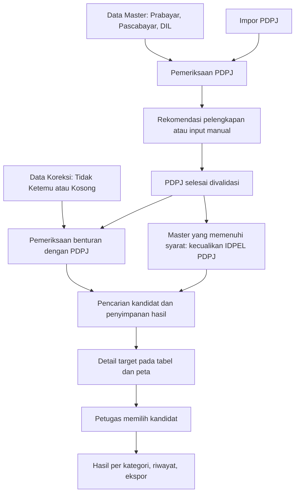

# Analisis perubahan alur PLN GeoMatch

Tanggal: 23 Oktober 2026.

Pembaruan 26 Oktober 2026: formulir impor mendukung [riwayat file dan sheet](riwayat-file-sheet.md), tanda sheet yang sudah disimpan, dan pemisahan pratinjau dari data acuan.

Catatan: dokumen ini merekam kondisi awal proyek. Lima perbaikan fondasi berikutnya dijelaskan pada [fondasi-data.md](fondasi-data.md). Implementasi tahap 1 (pemisahan Data Master dan dukungan DIL) dijelaskan pada [data-master.md](data-master.md), termasuk pengujian melalui browser terisolasi.

Implementasi tahap 2 (pemeriksaan, pelengkapan, riwayat, dan penyelesaian PDPJ) dijelaskan pada [validasi-pdpj.md](validasi-pdpj.md).

Implementasi tahap 3 (dua kategori Data Koreksi, pemeriksaan benturan PDPJ, ringkasan per target, dan kandidat tersimpan) dijelaskan pada [data-koreksi.md](data-koreksi.md).

Implementasi tahap 4 (peta kedua kategori, pemilihan target, radius, kandidat tersimpan, pilihan aktif, dan riwayat perubahan) dijelaskan pada [peta-koreksi.md](peta-koreksi.md). Tahap berikutnya adalah Hasil Koreksi dan ekspor per kategori.

Dokumen ini memetakan permintaan perubahan terhadap kode proyek yang tersedia. Analisis dilakukan melalui pembacaan source code, model database, endpoint, halaman frontend, PRD, dan pengujian yang sudah ada. Aplikasi dan database aktif belum diuji melalui UI. Dokumen ini tidak menyatakan fitur usulan sudah diimplementasikan.

## 1. Pemahaman kebutuhan

Master menjadi sumber rujukan yang dikelola terpisah dari data yang diperiksa. PDPJ masuk ke tahap pemeriksaan dan pelengkapan terlebih dahulu. Setelah PDPJ dinyatakan selesai, dua kelompok data koreksi diproses terhadap master yang sudah mengecualikan IDPEL PDPJ. Kandidat disimpan, diperiksa melalui tabel atau peta, lalu dipilih oleh petugas. Hasil mempertahankan data awal, data pilihan, jarak, dan riwayat kandidat.

Struktur navigasi yang diusulkan:

- Dashboard.
- Data Master: Prabayar, Pascabayar, DIL.
- Data PDPJ: impor, pemeriksaan, rekomendasi pelengkapan, penyelesaian validasi.
- Data Koreksi: IDPEL Tidak Ketemu dan IDPEL Kosong.
- Peta Koreksi: filter kedua kategori dan pemeriksaan per target.
- Hasil Koreksi: IDPEL Tidak Ketemu dan IDPEL Kosong.
- Riwayat Proses.

Kategori asal data koreksi tetap disimpan setelah kandidat dipilih. Contohnya, hasil dari data IDPEL Kosong tetap berada di kelompok hasil IDPEL Kosong walaupun IDPEL akhirnya sudah terisi.

## 2. Kondisi proyek saat ini

Frontend menggunakan React, TypeScript, Vite, dan Tailwind. Backend menggunakan FastAPI, SQLAlchemy, serta Celery untuk pekerjaan latar. Konfigurasi database mendukung PostgreSQL dengan fallback SQLite. Pencarian spasial aktual menggunakan perhitungan Haversine di Python. Peta aktual menggunakan Leaflet dari CDN dan tile OpenStreetMap.

Alur kode saat ini:

1. Halaman Upload menggabungkan unggahan Pascabayar, Prabayar, PDPJ, dan satu kelompok bernama `koordinat_kosong`.
2. Pembentukan master menggabungkan Pascabayar dan Prabayar, mengelompokkan IDPEL, dan memilih observasi berdasarkan pembandingan string periode.
3. IDPEL PDPJ dipakai sebagai daftar pengecualian master. PDPJ diasumsikan sudah terverifikasi kecuali status sumber termasuk beberapa nilai yang dianggap belum terverifikasi.
4. Target dicocokkan terhadap tabel Master Sisa berdasarkan radius. Secara bawaan hanya lima kandidat per target yang disimpan.
5. Halaman Kandidat menampilkan baris kandidat, marker target/kandidat, garis jarak, serta aksi menerima atau menolak.
6. Hasil menampilkan ringkasan dan ekspor CSV. Ekspor saat ini mengambil seluruh kandidat pada proses, termasuk yang belum dipilih atau ditolak.

File yang menjadi pusat perubahan:

| Bagian | File |
| --- | --- |
| Navigasi | `frontend/src/routes.tsx`, `frontend/src/components/layout/Sidebar.tsx` |
| Upload dan mapping | `frontend/src/pages/Upload.tsx`, `backend/app/modules/upload/router.py` |
| Pembentukan master | `backend/app/modules/spatial/master_builder.py` |
| Pengecualian PDPJ | `backend/app/modules/spatial/preparation.py` |
| Matching dan keputusan | `backend/app/modules/spatial/engine.py`, `backend/app/modules/spatial/router.py` |
| Peta dan tabel kandidat | `frontend/src/pages/Candidates.tsx` |
| Hasil dan ekspor | `frontend/src/pages/Result.tsx`, `backend/app/modules/history/router.py` |
| Model data | `backend/app/models/upload.py`, `backend/app/models/master_sisa.py`, `backend/app/models/matching.py` |

## 3. Selisih terhadap kebutuhan

| Kebutuhan | Kondisi kode | Perubahan yang diperlukan |
| --- | --- | --- |
| Master terpisah dari target | Masih satu halaman upload | Pisahkan fitur dan konteks dataset |
| DIL sebagai sumber master | Belum ada jenis dataset DIL; baru ada ekstraksi kode gardu | Tambahkan impor, mapping, penyimpanan sumber DIL, dan pencarian |
| PDPJ diperiksa ulang | Langsung digunakan untuk pengecualian | Tambahkan validasi IDPEL ke seluruh sumber master terpilih |
| Pelengkapan PDPJ | Belum ada alur rekomendasi atau input manual pelengkapan | Simpan temuan per sumber dan perubahan per field |
| Dua kategori koreksi | Digabung sebagai `koordinat_kosong` / `target` | Simpan kategori target secara eksplisit |
| Pemeriksaan benturan dengan PDPJ | Belum menjadi tahap validasi target | Tandai dan keluarkan target bentrok dari pencarian otomatis |
| Semua target dapat dilihat | Target tanpa koordinat dilewati mesin matching | Simpan status target walaupun tidak mempunyai kandidat |
| Ringkasan per kategori | Banyak hitungan berbasis kandidat; kartu review memakai data halaman aktif | Agregasi berdasarkan target unik dan kategori di backend |
| Peta semua target sesuai filter | Marker mengikuti kandidat pada halaman tabel aktif | Sediakan data titik target terpisah dari pagination tabel kandidat |
| Hover dan pemilihan titik | Popup klik; klik baris berfokus ke kandidat | Tambahkan tooltip hover dan pemilihan target yang tersinkron |
| Tombol proses per target | Belum ada alur tampilan yang diminta | Aktifkan sesudah target dipilih; ambil kandidat tersimpan |
| Detail sebelum/sesudah dan riwayat | Kandidat menyimpan sebagian field; keputusan ditimpa | Tambahkan snapshot, asal data, dan riwayat keputusan |

## 4. Alur yang diusulkan

### 4.1 Pengelolaan master

Setiap file Prabayar, Pascabayar, dan DIL disimpan bersama nama file, nomor baris, periode, mapping kolom, serta identitas sumber. Data asli dipertahankan. Satu IDPEL dapat mempunyai beberapa observasi dari file atau periode berbeda.

Pisahkan dua kebutuhan pencarian:

- Pemeriksaan keberadaan IDPEL memakai seluruh observasi master yang dipilih, termasuk yang koordinatnya belum lengkap.
- Pencarian kedekatan geografis memakai observasi dengan koordinat valid yang memenuhi aturan pengecualian.

Master tidak boleh membuang bukti keberadaan IDPEL hanya karena koordinat belum lengkap. Jika beberapa sumber memberikan koordinat berbeda, tampilkan konflik dan seluruh rekomendasi relevan. Pengelompokan untuk pencarian tidak boleh menghilangkan asal data.

### 4.2 Validasi dan pelengkapan PDPJ

1. Impor dan konfirmasi mapping PDPJ.
2. Normalisasi IDPEL sebagai teks tanpa menghilangkan nol di depan.
3. Cari kecocokan IDPEL pada seluruh sumber master yang dipilih.
4. Pisahkan status keberadaan IDPEL, kelengkapan data, dan status review. IDPEL ditemukan dengan koordinat kosong adalah kondisi ditemukan tetapi belum lengkap.
5. Tampilkan rekomendasi dari setiap sumber: field yang tersedia, nilai, file, baris, periode, dan kode DIL/gardu jika memang ada pada sumber.
6. Petugas memilih rekomendasi untuk mengisi field, memilih beberapa field dari sumber berbeda, atau mengisi manual. Field yang sudah terisi tidak ditimpa diam-diam.
7. Simpan data awal, perubahan, sumber rekomendasi, petugas, dan waktu.
8. Selesaikan validasi PDPJ setelah masalah terselesaikan atau diberi keputusan pengecualian yang jelas. Penyelesaian menjadi prasyarat proses koreksi.

Jika tidak ada master yang memiliki koordinat untuk IDPEL tersebut, sistem tetap mencatat IDPEL ditemukan dan menawarkan pelengkapan manual. IDPEL yang tidak ditemukan tidak boleh diberi label valid hanya karena baris berhasil diimpor.

### 4.3 Pemeriksaan dua kelompok data koreksi

Kedua kelompok mempunyai halaman masing-masing dengan mesin proses yang sama. Nama kelompok asal tidak menentukan hasil pemeriksaan terbaru: data yang diunggah sebagai Tidak Ketemu dapat ternyata ditemukan di master terbaru dan harus diberi penjelasan.

1. Impor kategori yang dipilih dan tampilkan seluruh target.
2. Jalankan tombol pemeriksaan/koreksi setelah PDPJ selesai.
3. Periksa benturan dengan PDPJ. Untuk IDPEL terisi, gunakan IDPEL yang dinormalisasi. Untuk IDPEL kosong, gunakan identitas bersama yang dapat dipercaya, misalnya nomor meter, nomor agenda, atau referensi survei. Koordinat sama saja menjadi indikasi duplikasi, bukan bukti pasti pelanggan sama.
4. Benturan ditampilkan beserta alasan; data asli tetap dapat dilihat dan tidak dihapus otomatis.
5. Bentuk kandidat dari master yang IDPEL-nya tidak termasuk PDPJ pada proses tersebut.
6. Simpan status per target, kandidat, jarak, radius pencarian, serta versi dataset yang digunakan.
7. Tampilkan notifikasi selesai setelah pekerjaan backend benar-benar selesai. Selesai pemeriksaan berbeda dari semua target sudah dipilih kandidatnya.

Kartu ringkasan yang disarankan: total target, bentrok dengan PDPJ, siap dicari, ditemukan kandidat, tanpa kandidat dalam radius, koordinat belum lengkap, dan sudah dipilih. Hitung target unik, bukan jumlah kandidat. Beberapa kartu merupakan ukuran yang saling beririsan sehingga tidak harus dijumlahkan menjadi total.

Klik Detail membuka data awal target, hasil pemeriksaan, dan daftar kandidat tersimpan di bawahnya. Target tanpa kandidat tetap mempunyai detail dan alasan hasil.

### 4.4 Peta dan radius

1. Filter kategori menentukan target pada peta dan tabel di bawahnya.
2. Tampilkan seluruh target yang mempunyai koordinat valid dalam cakupan filter; banyak titik dapat dikelompokkan agar tampilan tetap responsif. Pagination tabel tidak boleh membatasi himpunan titik peta.
3. Hover menampilkan informasi singkat dan menghilang ketika kursor meninggalkan titik. Pada perangkat sentuh, informasi tersedia melalui tap.
4. Klik titik atau baris tabel memilih target yang sama. Target aktif disorot; target lain berwarna abu-abu. Pemilihan target berbeda dari keputusan memilih kandidat.
5. Tombol pencarian/pemetaan aktif setelah target dipilih dan memiliki koordinat valid.
6. Setelah tombol dijalankan, tampilkan kandidat tersimpan, garis jarak, dan kartu detail di bawah peta. Daftar kandidat lengkap dapat dipaginasi.
7. Petugas memilih kandidat melalui kartu. Penyimpanan keputusan harus selesai sebelum UI menyatakan berhasil.

Radius perlu mengikuti cakupan kandidat yang tersimpan. Jika data kandidat sudah lengkap sampai radius R, radius lebih kecil dapat memakai hasil tersimpan. Radius lebih besar dari R memerlukan pencarian tambahan pada backend, lalu hasil tambahannya disimpan. Master tidak perlu dikirim atau diunggah ulang ke frontend. Menyimpan lima kandidat saja tidak cukup untuk menjamin seluruh kandidat pada radius yang sama dapat ditampilkan.

Target tanpa koordinat tetap terlihat pada tabel dan kartu ringkasan, dengan aksi melengkapi data. Jangan menaruhnya pada titik koordinat palsu seperti 0,0.

### 4.5 Pemilihan dan hasil

Setiap target mempunyai paling banyak satu kandidat terpilih aktif pada satu proses. Seluruh kandidat lain tetap tersimpan untuk pemeriksaan ulang. Pergantian pilihan menghasilkan riwayat, bukan menghapus pilihan lama.

Hasil dipisahkan berdasarkan kategori asal dan menampilkan:

- Data asli target dan kondisi sebelum koreksi.
- Data hasil pilihan beserta perubahan field.
- IDPEL, koordinat, nama, dan sumber master yang dipilih.
- Jarak pilihan dalam meter, peringkat, dan radius saat pencarian.
- Seluruh kandidat tersimpan per pencarian, termasuk kandidat dari pencarian ulang.
- Riwayat pilihan, petugas, waktu, dan alasan jika ada.

Ekspor utama berisi hasil yang sudah dipilih sesuai kategori dan proses aktif. Ekspor detail kandidat/riwayat dapat disediakan terpisah agar riwayat tetap dapat ditelusuri. Hasil lama menggunakan snapshot sumber dan parameter prosesnya sendiri, sehingga perubahan master kemudian tidak mengubah laporan lama.

## 5. Perbaikan fondasi yang diperlukan

1. **Identitas target dan relasi sumber.** Kandidat saat ini mengacu pada `target_ref` teks tanpa foreign key ke record target. Tambahkan identitas target stabil serta relasi proses ke batch master, PDPJ, dan target yang digunakan.
2. **Pemisahan data per proses.** Master Sisa saat ini merupakan tabel global yang dikosongkan pada pengecualian PDPJ. Hindari proses lain menimpa himpunan kandidat dengan membuat cakupan proses/snapshot yang eksplisit.
3. **Tidak berpindah proses diam-diam.** Endpoint kandidat dan ringkasan mempunyai fallback ke proses lain. Kembalikan hasil kosong/tidak ditemukan untuk proses yang diminta agar kategori dan riwayat tidak tercampur.
4. **Mapping benar-benar diterapkan.** Endpoint konfirmasi mapping saat ini menyimpan metadata mapping dan menandai seluruh baris tersimpan sebagai valid; ekstraksi berikutnya masih mengandalkan alias nama kolom. Terapkan mapping dan validasi per baris sebelum status valid diberikan. Di frontend, kolom koordinat PDPJ yang diberi label opsional masih ikut diwajibkan oleh pemeriksaan mapping.
5. **Perlindungan format IDPEL.** Pembacaan CSV/Excel saat ini membiarkan pandas menyimpulkan tipe data. Pertahankan IDPEL dan referensi sebagai teks sejak impor; nilai yang sudah kehilangan presisi harus ditandai.
6. **Target tanpa kandidat.** Mesin saat ini melewati target tanpa koordinat dan membuat baris kandidat sintetis ketika tidak ada kandidat dalam radius. Simpan hasil target secara terpisah; nol kandidat adalah kondisi yang sah dan berbeda dari koordinat belum lengkap.
7. **Keputusan dan riwayat.** Endpoint keputusan saat ini mengubah flag kandidat secara langsung. Tambahkan aturan satu pilihan aktif per target serta riwayat keputusan. Pencarian ulang tidak boleh menghapus kandidat/keputusan lama seperti penghapusan kandidat pada awal job saat ini.
8. **Kinerja pencarian.** Mesin saat ini menghitung jarak setiap target terhadap semua Master Sisa. Untuk volume besar, gunakan pencarian berindeks di backend sesuai kemampuan database; frontend tetap menerima hasil kandidat dan titik yang diperlukan.
9. **Status pekerjaan yang akurat.** Halaman kandidat saat ini meminta status ke `/history/process/{id}/summary`, sementara endpoint yang tersedia adalah `/process/{id}/summary`. Selaraskan endpoint agar polling dan notifikasi selesai dapat diandalkan.

Entitas konseptual tambahan yang dibutuhkan: observasi master beserta sumber, hasil validasi PDPJ dan rekomendasinya, target koreksi beserta kategori/statusnya, hubungan dataset per proses, pencarian kandidat berversi, pilihan aktif, serta riwayat keputusan/perubahan. Nama tabel final dapat mengikuti pola proyek setelah rancangan migrasi ditetapkan.

## 6. Urutan implementasi

1. Tetapkan model status, kategori, relasi sumber, snapshot proses, dan migrasi yang mempertahankan data lama.
2. Benahi impor/mapping dan pisahkan pengelolaan Master, termasuk DIL.
3. Bangun validasi dan pelengkapan PDPJ, lalu prasyarat penyelesaiannya.
4. Bangun dua fitur Data Koreksi: benturan PDPJ, pemeriksaan, ringkasan, detail target, dan penyimpanan kandidat.
5. Sesuaikan peta dengan pemilihan target, hover, radius, serta penggunaan kandidat tersimpan.
6. Bangun hasil per kategori, riwayat perubahan/pilihan, dan ekspor.
7. Uji alur terpadu dan migrasi, terutama isolasi antarproses dan pemulihan pekerjaan gagal.

## 7. Skenario penerimaan utama

- PDPJ dengan IDPEL ditemukan tetapi koordinat kosong tetap dikenali sebagai ditemukan; seluruh rekomendasi sumber dapat diperiksa.
- PDPJ yang sudah lengkap tidak ditimpa tanpa tindakan petugas.
- IDPEL yang ada pada PDPJ terpilih tidak masuk kandidat koreksi.
- Target tanpa IDPEL diperiksa terhadap identitas bersama; kemiripan koordinat tidak langsung menghapus target.
- Target tanpa koordinat atau tanpa kandidat tetap terlihat dan dihitung dengan status yang tepat.
- Satu target dengan lima kandidat dihitung sebagai satu target pada kartu ditemukan.
- Klik baris dan klik marker menghasilkan pilihan target yang sama; tombol pemetaan mengikuti keadaan pilihan.
- Radius kecil memakai kandidat tersimpan; perluasan radius menghasilkan pencarian tambahan jika cakupan simpanan belum cukup.
- Memilih kandidat kedua mengganti pilihan aktif dan mempertahankan riwayat pilihan pertama.
- Hasil/ekspor hanya mengambil kategori dan proses yang diminta, tanpa fallback ke proses lain.
- Pembaruan master dan pencarian ulang tidak mengubah snapshot hasil historis.
- Status selesai baru tampil setelah job selesai, bukan setelah pengiriman permintaan atau timer tampilan.

## 8. Rincian yang perlu dipastikan saat implementasi

- Contoh struktur DIL dan arti kode yang ingin ditampilkan, agar kode gardu, kode sumber, dan nomor baris tidak disamakan.
- Field identitas bersama pada PDPJ dan IDPEL Kosong untuk pemeriksaan duplikasi tanpa IDPEL.
- Cakupan master/PDPJ per periode: satu file, snapshot terbaru, atau gabungan file yang dipilih. Usulan teknis: pilihan eksplisit yang disimpan per proses.
- Perlakuan PDPJ yang belum dapat dilengkapi. Usulan: tetap berstatus masalah sampai dilengkapi atau diberi keputusan pengecualian dengan alasan.
- Apakah satu IDPEL master boleh dipilih untuk beberapa target koreksi berbeda. Minimal tampilkan benturan; aturan penolakan memerlukan dasar operasional.

PRD lama memperlakukan PDPJ sebagai daftar pengecualian yang sudah terverifikasi dan DIL sebagai fitur lanjutan. Permintaan terbaru mengganti asumsi tersebut: PDPJ perlu divalidasi terlebih dahulu dan DIL masuk sumber master. Kebutuhan terbaru menjadi acuan perubahan; dokumen lama perlu diselaraskan saat implementasi.
